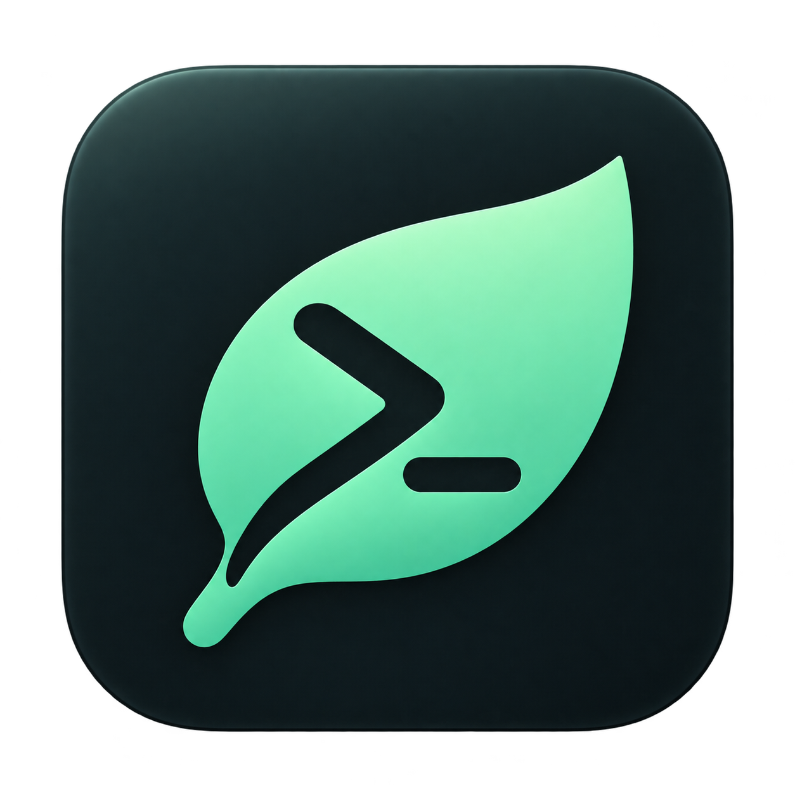
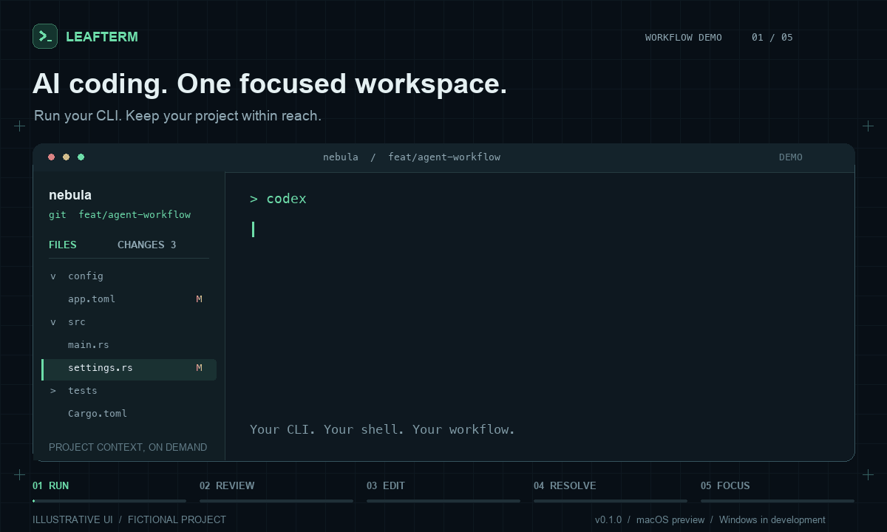

<div align="center">



# LeafTerm

### Your agent’s terminal. Your code, in view.

Keep the workflow. Skip the extra IDE.

<p>
  <a href="README.md"></a>
  <a href="README.zh-CN.md"></a>
</p>

<p>
  
  
  
  
  
  
</p>

<p>
  <a href="https://github.com/Arise-cn/LeafTerm/releases/download/v0.1.0/LeafTerm-0.1.0-macos-arm64.zip"></a>
  <br />
  <sub>v0.1.0 preview · ZIP · <a href="https://github.com/Arise-cn/LeafTerm/releases/tag/v0.1.0">Release notes</a></sub>
</p>

[Quick start](#quick-start) · [Features](#features) · [Shortcuts](#shortcuts) · [User guide](docs/guide.md) · [Report an issue](https://github.com/Arise-cn/LeafTerm/issues)

</div>

---

Your AI agent is already writing code in the terminal. But checking a branch, reviewing its changes, tweaking a config, or resolving a conflict can still mean opening a full IDE.

**LeafTerm brings those everyday tasks into your terminal workspace.** A file tree, Git diffs, a small editor, and conflict resolution stay close at hand. Open the sidebar when you need context; press `⌘B` to give the space back to your terminal. Built in Rust with GPU rendering, LeafTerm is designed to keep resource use modest and help you work without an extra IDE running alongside your agent.

<p align="center">
  
  <br />
  <sub>Workflow illustration, not a screen recording. Fictional project and example content. <a href="docs/images/workflow-poster.png">Static preview</a>.</sub>
</p>

> **macOS development preview · Windows in development**
> The current build runs on macOS using Metal and is developed and tested primarily on Apple Silicon. Windows is not available yet. Low memory use is a design goal; no comparative benchmarks have been published. GPU rendering still uses system memory.

<a id="features"></a>

## A terminal with your project in view

| | What you can do |
| :--- | :--- |
| **Review your agent’s changes** | See the current branch, file status, and diffs in the sidebar. Distinguish staged, unstaged, untracked, and conflicted files. Git worktrees are supported. |
| **Find a file quickly** | Press `⌘P` to search filenames and relative paths, including folders you haven’t expanded. Browse the file tree with Git change markers. |
| **Make that small edit** | Open a text file, edit with syntax highlighting, save with `⌘S`, and undo with `⌘Z`. External change detection helps protect edits your agent has just written. |
| **Resolve conflicts visually** | Compare Current and Incoming, keep either side or both, and adjust the result by hand. Undo a choice, save the result, then explicitly mark the file resolved. |
| **Arrange your workspace** | Use shortcuts for new windows, horizontal or vertical splits, pane focus, and pane zoom. Drag dividers to adjust the layout. |
| **Keep the space for your terminal** | Toggle the sidebar with `⌘B`; LeafTerm remembers your choice. No persistent tab strip or toolbar. The app icon and ink-and-mint palette carry the visual identity. |

Underneath it all: a real local shell and PTY, ANSI 16-color / 256-color / truecolor output, Unicode, text selection, copy and paste, and scrollback.

<a id="quick-start"></a>

## Quick start

1. [Download LeafTerm v0.1.0 for macOS Apple Silicon](https://github.com/Arise-cn/LeafTerm/releases/download/v0.1.0/LeafTerm-0.1.0-macos-arm64.zip) and unzip it.
2. Drag `LeafTerm.app` into **Applications** (`/Applications`).
3. Open LeafTerm. If macOS blocks the app, follow the [first launch instructions](#macos-first-launch) below.

The download is an **Apple Silicon development preview** without Apple Developer ID signing or Apple notarization. You do not need to clone the repository or install Rust to use it. The Git sidebar requires a working local Git installation.

Inside LeafTerm, run the tools you already have installed:

```sh
codex
# or
claude
```

LeafTerm uses your local shell. It does not bundle an AI CLI, model, or sign-in service.

<details>
<summary><strong>Build from source (optional)</strong></summary>

Source builds require **macOS, a stable Rust toolchain, Xcode Command Line Tools, and Git**.

```sh
git clone https://github.com/Arise-cn/LeafTerm.git
cd LeafTerm
cargo run --release -- --fresh .
```

To open your own project:

```sh
cargo run --release -- --fresh /path/to/your/project
```

Running `cargo run --release` without a directory attempts to restore your previous window layout and working directories. To build a macOS app with a Dock icon:

```sh
./scripts/bundle.sh
open dist/LeafTerm.app
```

The script creates `dist/LeafTerm.app` inside the repository. To replace an existing bundle, use `./scripts/bundle.sh --force`.

This is an ad-hoc signed bundle for local development. It is not signed with Apple Developer ID or notarized by Apple. See [building and launching](docs/guide.md#getting-started) for all launch and packaging options.

</details>

<a id="macos-first-launch"></a>

### First launch on macOS

The current app has an ad-hoc signature, but no Apple Developer ID signature or Apple notarization. If macOS says the app is “damaged” or that the developer cannot be verified on first launch, and you trust the app's source, move `LeafTerm.app` to `/Applications`, open the system **Terminal** app, and run:

```sh
sudo xattr -cr "/Applications/LeafTerm.app"
```

Enter your administrator password and press Return; password characters are not displayed as you type. When the command finishes, reopen LeafTerm. If the app is stored elsewhere, replace the quoted path with its actual location.

This command recursively clears the app's extended attributes, including quarantine. It does not repair actual file corruption; if the app still fails to open, download it again.

## From agent output to reviewed changes

**1. Keep your agent working in the terminal.** Continue in your familiar CLI. Let the sidebar follow the current directory, or pin it to a project.

**2. Open what you need in Files.** Press `⌘P`, enter a filename, and hit Return. Tweak a config, check the code, save, and get back to the terminal.

**3. Review the result in Changes.** Inspect the actual diff. For a text conflict, choose Current, Incoming, or Both for each section, then check the final result.

The Git sidebar is normally read-only. **Mark resolved** in the conflict editor stages the current saved file. You run commits and continue merges or rebases yourself in the terminal.

<a id="shortcuts"></a>

## Fewer clicks. More room.

| Shortcut | Action |
| :--- | :--- |
| `⌘ B` | Show / hide the sidebar |
| `⌘ P` | Search files |
| `⌘ E` | Switch between Files and Changes |
| `⌘ D` / `⌘ ⇧ D` | Split right / split down |
| `⌘ ⌥ ←` / `⌘ ⌥ →` | Focus the previous / next pane |
| `⌘ ⇧ Enter` | Zoom the current pane / restore layout |
| `⌘ N` | New window |
| `⌘ S` | Save the file |
| `⌘ Z` / `⌘ ⇧ Z` | Undo / redo edits and conflict choices |
| `⌘ F` | Search terminal history |

There’s also directory completion for `cd` in zsh, font size control, and layout restoration. See the [full shortcut list](docs/guide.md#shortcuts) and [user guide](docs/guide.md).

## Designed to leave room for your workflow

- **Render with the GPU.** `winit` handles native windows and input; `wgpu` / Metal and `glyphon` draw the interface and text.
- **Load project context on demand.** Expand folders as needed. File searches run in the background, cancel outdated queries, and keep no persistent project-wide index.
- **Keep editing focused.** Syntax highlighting runs in the background and updates incrementally, without starting a language server or plugin host.
- **Bound growing data.** Scrollback, editable file sizes, search results, and undo history have explicit limits. Use your existing command-line tools for larger tasks.

The terminal core uses `alacritty_terminal`, local processes run through `portable-pty`, and `syntect` supplies syntax highlighting. Parsing, text layout, and file handling still require CPU work. See the [resource limits](docs/guide.md#resource-limits) for details.

<details>
<summary><strong>Current support and known limitations</strong></summary>

- The runnable build currently supports macOS Metal only. **Windows support is in development** and is not available yet. Linux is not supported; compatibility with other Macs still needs testing.
- Editing supports **regular UTF-8 files up to 256 KiB**. Larger files, binary files, non-UTF-8 files, and symlinks are presented read-only.
- TypeScript currently uses the JavaScript highlighting grammar. There is no type checking, language server, or semantic diagnostics.
- The conflict UI supports common text conflicts, including diff3 / zdiff3. Modify/delete, binary, and other unsupported conflicts must be handled in the terminal.
- Restoring a layout starts new shells. It **does not resume previous AI processes or commands**.
- Chinese input method composition, prolonged stress testing, and complete AI CLI workflows are still being validated. Full Kitty keyboard protocol support, terminal image protocols, and screen reader semantics are not available yet.

More details: [Editing](docs/guide.md#editing) · [Highlighting](docs/guide.md#highlighting) · [Conflicts](docs/guide.md#merge-conflicts) · [Layout restoration](docs/guide.md#session-restore)

</details>

## Help shape LeafTerm

Found something that gets in the way? [Open an issue](https://github.com/Arise-cn/LeafTerm/issues). Improvements are welcome, too. For bug reports, include your macOS version, chip, shell and AI CLI versions, steps to reproduce, and screenshots or logs with sensitive information removed.

Local development checks:

```sh
cargo fmt --check
cargo test --locked
cargo clippy --all-targets --locked -- -D warnings
```

[User guide](docs/guide.md) · [Color troubleshooting](docs/guide.md#terminal-colors) · [Development and testing](docs/guide.md#development)

LeafTerm is available under the [MIT License](LICENSE). Third-party dependencies retain their own licenses.

---

<p align="center">
  <strong>LeafTerm</strong><br />
  <sub>Your code, in view.</sub>
</p>
